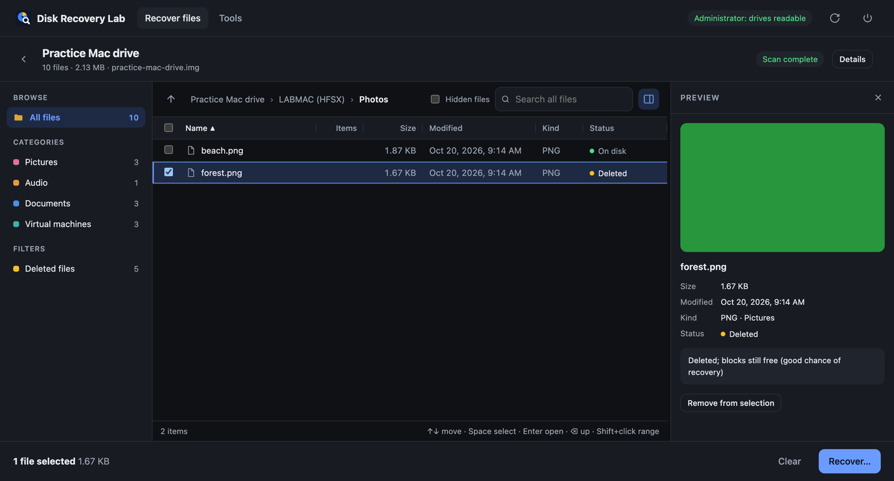

<p align="center"></p>
<h1 align="center">Disk Recovery Lab</h1>
<p align="center">Scan a drive, browse what can be recovered, and copy back only the files you choose.<br>
One file, no installation, for macOS, Windows and Linux.</p>

<p align="center"></p>

## What it does

- **Reads drives your computer refuses to open.** It parses filesystems itself, so a Mac drive that macOS will
  not mount, or a Mac drive plugged into Windows, can still be browsed.
- **Scan first, decide later.** A scan writes nothing. Results are saved, so you can close the app and come back
  days later, browse folders, filter by type, preview, and tick exactly what you want.
- **Finds deleted files.**
  - *Quick scan* reads the file list, including deleted entries that are still in the filesystem's catalog and journal.
    These come back **with their original names and folders**.
  - *Deep scan* searches free space for photos, documents, video, audio and archives by their content.
- **Safe by design.** The source is only ever opened read-only, recovered files must go to a different drive,
  and repairs are only ever made to a copy.

| | Quick scan (names and folders) | Deep scan (by content) |
|---|---|---|
| HFS+ / HFSX (Mac drives) | ✅ including deleted entries | ✅ free space only |
| FAT, exFAT, NTFS, APFS, ext4… | planned, see [ROADMAP](docs/ROADMAP.md) | ✅ whole partition |

Extra tools: diagnose why a disk is unreadable, find lost partitions, make a byte-to-byte image of a failing drive,
restore a wiped FAT32/exFAT/NTFS boot sector inside a copy, run the system's read-only filesystem check, and mount
read-only.

## Download and run

Get the file for your system from the [Releases](../../releases) page:

| System | File |
|---|---|
| macOS 11+ (Apple Silicon and Intel) | `DiskRecoveryLab-macos-universal.zip`: unzip, then open **Disk Recovery Lab** |
| Windows 10/11 x64 | `DiskRecoveryLab-windows-x64.exe` |
| Windows on ARM | `DiskRecoveryLab-windows-arm64.exe` |
| Linux x64 / ARM64 | `disk-recovery-lab-linux-x64` / `-arm64`: `chmod +x` it, then run it |

Reading a drive directly needs administrator rights, so the app asks once when it starts: the password prompt on
macOS, *Yes* in the Windows prompt, or pkexec on Linux. If you decline, you can still open disk images and saved scans.
The interface opens in its own window (in Chrome/Edge app mode when available, otherwise in your browser).

**First launch of an unsigned build:**
- **macOS:** right-click the app, choose **Open**, then **Open** again.
- **Windows:** in SmartScreen, choose **More info**, then **Run anyway**.

## How to recover files

1. **Choose a drive**, or one of its partitions, or a disk image file.
2. **Scan.** *Quick* takes minutes. *Quick + deep* can take hours on large drives; you can stop at any time and keep
   what was found.
3. **Browse and pick.** Use folders, categories, *Deleted files*, search and preview, then tick files or whole folders.
4. **Recover** to another drive. Folder structure and dates are kept.

On a drive that makes noises or shows read errors, make an image first (**Tools → Byte-to-byte image**) and scan the image.
On SSDs, deleted data is often erased by TRIM soon after deletion, so a deep scan may find little there. Files still
listed in the catalog are not affected.

## Build from source

Requires Go 1.26+.

```sh
go test ./...
go run ./cmd/disk-recovery-lab --no-elevate    # images only, quick to try
scripts/build.sh                                # all release files into dist/ (the .app needs macOS)
```

Useful flags: `--no-elevate`, `--no-ui` (print the URL), `--port`, `--data-dir`, `--version`.

See [docs/ARCHITECTURE.md](docs/ARCHITECTURE.md) for how the code is organised.

## Contributing

Contributions are welcome. Filesystem readers (NTFS, APFS, exFAT, FAT, ext4) and new file signatures are the most
useful places to help. Please read [CONTRIBUTING.md](CONTRIBUTING.md) and the [Code of Conduct](CODE_OF_CONDUCT.md).
Report security issues privately as described in [SECURITY.md](SECURITY.md).

## License

[Apache License 2.0](LICENSE). The code is written from public format documentation, such as Apple's *TN1150 HFS Plus
Volume Format*, and contains no code from other recovery products.

**No warranty.** Recovery is best-effort. For data that matters, work on an image of the drive, and consider a
professional lab for physically damaged drives.
